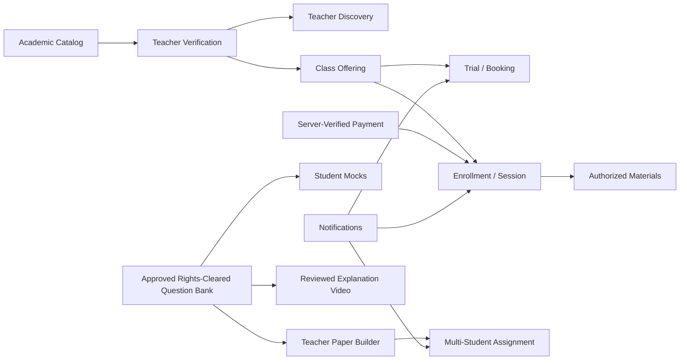

# UR GURU — Modules and Features Inventory

| Field | Value |
|---|---|
| Document ID | `OV-05` |
| Version / prepared | Draft 1.0 / 19 November 2026 |
| Approval | **DRAFT — MODULE INVENTORY FOR REVIEW** |
| Primary source | [BRD V6.1 §8 and §13–14](../02-BRD-AND-REQUIREMENTS/UR_GURU_BRD_V6_1_CORRECTED_BASELINE.md) |

## 1. Module inventory by phase

This list follows the BRD's `BR-01`–`BR-21` register; it is **not** a claim that an API, schema, UI or code module already exists. `Must` means must for the **specified phase**, not for all releases.

### Phase 1 — Core tuition marketplace

| Module | Requirement ID(s) | Key features | Main owner / actor | Example acceptance mapping |
|---|---|---|---|---|
| Identity, Student Onboarding | `BR-01` | Register/login/recover/logout; A/L grade/stream/subject/medium; own profile | Student; backend identity service | `AC-01` |
| Teacher Verification | `BR-02` | Application/evidence; review states; approve/reject/suspend; publishing gate | Teacher, Admin | `AC-02` |
| Teacher Discovery | `BR-03` | Public approved profiles; subject/medium/fee/schedule/trial filters; availability | Student | `AC-03` |
| Free Trials | `BR-04` | Eligible trials; seat reservation; status history; cancellation/no-show handling under policy | Student, Teacher, Admin | `AC-04` |
| Course/Class, Session & Attendance | `BR-05` | Class/batch offering, timetable, capacity, enrollment, live join entitlement, reschedule/cancel, attendance | Teacher, Student, Admin | `AC-05`, `AC-06` |
| Orders, Payments & Finance | `BR-06` | Payment attempts, provider verification, receipts/entitlements, commission, refund, earning, payout and ledger audit | Student, Admin/Finance, Teacher | `AC-07`, `AC-08` |
| Learning Resources | `BR-07` | Class-linked approved files, versioning, enrolled access, restricted links | Teacher, Student | `AC-09` |
| Essential Notifications | `BR-13` | Trial/booking, payment, class changes, safety and operational notices | All role-relevant recipients | `AC-04`, `AC-05`, `AC-10` |
| Administrator Operations | `BR-14` | Academic catalogue, teacher review, moderation, support, finance exceptions and audit | Admin | `AC-02`, `AC-10`, `AC-19` |
| Consent, Safety & Complaints | `BR-21` | Consent evidence, student report, restricted case escalation, contact/recording controls | Student, Admin, authorized safeguarding officer | `AC-10`, `AC-19` |

**Key boundary:** Admin controls the master academic catalogue. Teacher creates **class offerings** tied to approved subjects, while students select subjects and enroll in/attend classes. Do not equate `Subject` and teacher-created `Class`.

### Phase 2 — Exam Munnodi

| Module | Requirement ID(s) | Key features | Main actor | Example acceptance mapping |
|---|---|---|---|---|
| Assessments & Progress | `BR-11` | Attempt history, scores, topic-level performance, sufficient-evidence safeguards | Student, authorized Teacher | `AC-14` |
| Question Bank & Mock Engine | `BR-18` | Reviewed rights-cleared past-paper questions, A/L syllabus/medium/translation versions; topic/all-topic and difficulty selection; generated mock; autosave/submit/scoring | Student, Reviewer/Admin | `AC-11`–`AC-14`, `AC-18` |
| Teacher Paper Builder | `BR-19` | Search approved read-only bank, draft, preview, order items, publish; individual/multi-student assignment; independent results | Approved Teacher, assigned Student | `AC-15`, `AC-16` |
| Video Explanations | `BR-20` | Teacher upload, metadata/rights, review, corrections, published playback with written fallback | Teacher, Academic Reviewer, Student | `AC-17`, `AC-18` |

The exact exam timer, question count, retake, marks, difficulty and digital-product entitlement rules remain `OD-10`, `OD-11`, `OD-13` **PENDING APPROVAL**.

### Later / Future — Not committed to the current releases

| Module | Requirement ID | Stage | Gate |
|---|---|---|---|
| Tamil lecture transcription | `BR-08` | Later | Recording consent, quality/cost review |
| Teacher-reviewed AI revision notes | `BR-09` | Later | Teacher approval, secure data use |
| Personalized AI learning assistant | `BR-10` | Later | Provider, age/academic safety, cost controls |
| ExamPilot academic journey | `BR-12` | Future | Business case/approval |
| Academic counselling | `BR-15` | Future | Separate scope approval |
| Full guardian dashboard | `BR-16` | Future | Legal, privacy and feature approval |
| DataSmart/offline enhancements | `BR-17` | Future | Technical, privacy and budget approval |

## 2. Cross-cutting platform capabilities

| Capability | Applies to | Core rule |
|---|---|---|
| Authentication & RBAC | All | Backend-verified role and record access |
| A/L academic catalogue | Discovery, classes, Exam Munnodi | Approved stream/subject/syllabus/topic/medium mappings |
| Object/media storage | Class resources, explanation video | Restricted files, review and signed/time-limited access |
| Notifications | Trial/classes, payments, papers and safety | Send only to authorized recipients |
| Audit/observability | Verification, payments, exams, moderation, access | Trace privileged and state-changing operations |
| Consent and safeguarding | All student experiences | Privacy/legal review and reporting rules |
| Reconciliation/idempotency | Payment, refund, exam submit, assignments | Prevent duplicate side effects |

## 3. Suggested dependency map (BRD-supported relationships)

For implementation order/gating see [Release Roadmap](Release-Roadmap.md) and BRD §13.1. Edges illustrate dependencies, not an authoritative service deployment topology.

## 4. Feature specification checklist (repeat for each feature)

Every development-ready feature should have:

1. Unique `BR-xx` and `AC-xx` reference and phase.
2. Actor, business preconditions and permissions.
3. UI screen/route, form fields, loading/empty/error/success states.
4. Data entities/constraints and API contract references **after approval**.
5. Input validations, transitions, cancellation/retry/error handling.
6. Audit/privacy/consent and access-boundary considerations.
7. Positive, negative and exception test cases and acceptance evidence.

Populate actual traceability in [Requirements-Traceability.csv](../02-BRD-AND-REQUIREMENTS/Requirements-Traceability.csv) when the corresponding screen, API, table and test IDs are verified. **Do not invent IDs to make the matrix look complete.**

## 5. Known documentation conflicts to resolve before implementing modules

- BRD V6.1 is a **review baseline**, not signed final approval.
- Current schema/ERD files may not model Exam Munnodi translation/versioning and the guardian boundary consistently.
- Repository's API totals and actual Excel endpoint inventory require reconciliation.
- Frontend framework and DB engine require technical sign-off; the **current ZIP contains PostgreSQL SQL, while BRD proposes SQL Server**.
- UI prototypes are not proof of finished, approved user journeys.

See [Decision Register](../13-DECISION-LOG/DECISIONS_AND_OPEN_ITEMS.md) and [Scope](Project-Scope.md).
