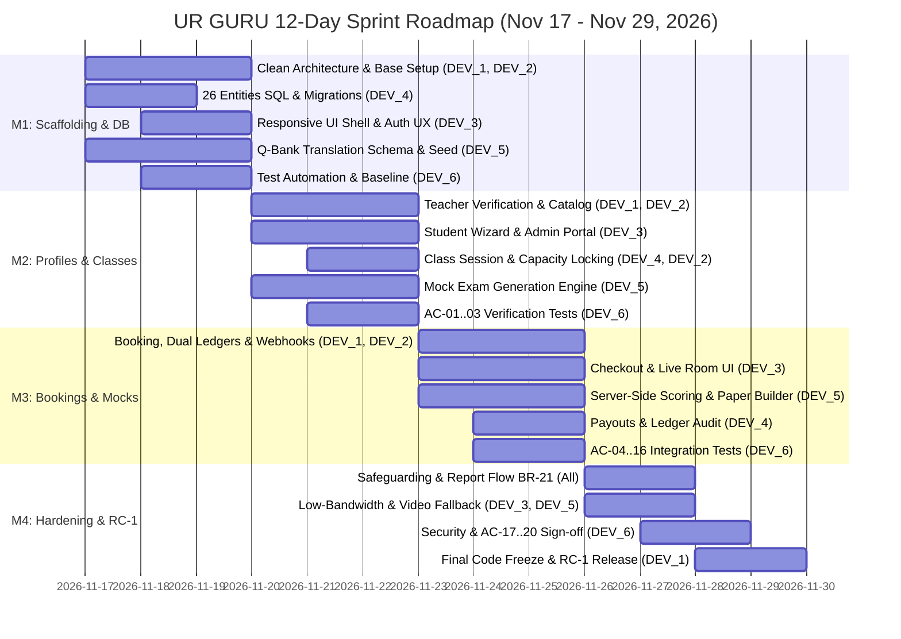

# UR GURU — 12-Day Development Milestone Plan (Nov 17 – Nov 29, 2026)

**Project:** UR GURU (A/L Online Education Marketplace & Exam Munnodi)  
**Governing Baseline:** BRD Version 6.1 (17 Nov 2026) & Overall ERD (26 Entities)  
**Project Lead:** Jochim (`DEV_1`)  
**Team Capacity:** 6 Dedicated Engineers  
**Target Completion:** 29 November 2026 (Ready for Release Candidate RC-1)

---

## 1. High-Level Milestone Roadmap (Gantt Overview)

---

## 2. Detailed Milestone Breakdown

### 🎯 Milestone 1 (Days 1–3: Nov 17 – Nov 19) — Architecture, Schema & Foundation
**Goal:** Running C# Web API solution, 26-entity database migrated and seeded, responsive UI shell running, JWT authentication working end-to-end.

| Member | Daily Tasks & Ownership | Target Deliverable |
|---|---|---|
| **DEV_1** *(Jochim)* | Setup ASP.NET Core 8.0 Clean Architecture (`Domain`, `Application`, `Infrastructure`, `WebApi`), Solution configuration, API error envelope middleware, CI/CD build script. | Solution builds cleanly, shared DTO contracts defined. |
| **DEV_2** *(Backend)* | Implement User authentication endpoints (`POST /api/v1/auth/register`, `POST /api/v1/auth/login`), Password hashing, JWT token generation & validation middleware (`BR-01`). | Working JWT Auth API with role-based access. |
| **DEV_3** *(Frontend)* | Responsive web shell setup (Angular / Web), Header, Navbar, Theme tokens (`#4F46E5`), Auth screens (`AU-01` to `AU-04`) with client-side form validation (Preventing BUG-001). | Responsive Login & Register UI connected to Auth API. |
| **DEV_4** *(Database)* | Microsoft SQL Server DDL execution for 26 entities, EF Core DbContext & Fluent API configurations, Seed script for 4 A/L Streams, Subjects & Topics. | Database created, migrated, and seeded with A/L syllabus master. |
| **DEV_5** *(Exam)* | Question bank data models (`QuestionConcept`, `QuestionTranslation`, `QuestionOption`), past-paper MCQ JSON seed parser. | Question bank schema ready with sample A/L questions. |
| **DEV_6** *(QA)* | Postman/REST test suite for Auth API, Playwright setup for UI validation tests, Negative test cases for empty/malformed inputs. | Automated regression test suite initialized. |

**Milestone 1 Gate:** Student can register, login, receive a JWT token, and see the responsive dashboard shell.

---

### 🎯 Milestone 2 (Days 4–6: Nov 20 – Nov 22) — Profiles, Teacher Vetting & Class Operations
**Goal:** Complete Student & Teacher profiles, Teacher verification pipeline by Admin, Class creation with weekly sessions, and Mock Exam Generator.

| Member | Daily Tasks & Ownership | Target Deliverable |
|---|---|---|
| **DEV_1** *(Jochim)* | Review PRs from Devs 2–5, implement MediatR commands/queries, enforce dependency rules, review teacher verification flow. | Core pipeline architecture stable. |
| **DEV_2** *(Backend)* | Student Academic Profile endpoints (`BR-01`), Teacher onboarding & document upload (`BR-02`), Admin teacher approval endpoints (`BR-14`), Class & Session creation API (`BR-05`). | Full class scheduling and teacher vetting API. |
| **DEV_3** *(Frontend)* | Student academic profile setup wizard (`PF-01`, `PF-02`), Teacher dashboard & class creation wizard, Admin teacher approval portal UI. | Teacher class creation & student stream selection screens active. |
| **DEV_4** *(Database)* | Indexes for teacher search filters (`stream`, `subject`, `medium`, `fee`), Transactional seat reservation logic to prevent class overbooking (`AC-06`). | High-performance search and concurrency control. |
| **DEV_5** *(Exam)* | Mock Exam Generator API (`POST /api/v1/mocks/generate`), topic/difficulty selection algorithm, question shortage handling without fake data (`AC-07`, `AC-13`). | Working mock exam generation endpoint. |
| **DEV_6** *(QA)* | Automated tests for `AC-01` (A/L scope only), `AC-02` (Unverified teacher cannot publish), `AC-03` (Discovery), and `AC-11` (Active questions only). | Acceptance tests passing for Milestone 2. |

**Milestone 2 Gate:** Verified teacher can create and publish a tuition class with timetable; student can generate a customized A/L mock exam.

---

### 🎯 Milestone 3 (Days 7–9: Nov 23 – Nov 25) — Bookings, Payments, Exam Engine & Teacher Papers
**Goal:** Student class booking & payment webhook, dual-ledger accounting, mock exam taking with server-side scoring, and Teacher Paper Builder.

| Member | Daily Tasks & Ownership | Target Deliverable |
|---|---|---|
| **DEV_1** *(Jochim)* | Dual Ledger segregation (`16-FINANCE`): Tuition GMV vs Exam Munnodi digital products, idempotency filter on webhooks, review exam scoring integrity. | Financial architecture and exam security verified. |
| **DEV_2** *(Backend)* | Class booking API (`POST /api/v1/classes/{id}/book`), Free trial management (`BR-04`), Payment gateway webhook receiver & verification (`BR-06`), Live room join authorization token (`BR-05`). | End-to-end booking & payment confirmation backend. |
| **DEV_3** *(Frontend)* | Booking & checkout review screen (`EN-01`, `PY-01`, `PY-02`), Waiting room & live session launcher (`CL-04`, `CL-05`), Exam Munnodi taking UI (timer, LaTeX equations, autosave). | Student checkout and exam taking UI complete. |
| **DEV_4** *(Database)* | Financial tables (`payments`, `payment_transactions`, `teacher_earnings`, `teacher_payouts`, `refunds`), Payout calculation views. | Financial ledger schema and payout views active. |
| **DEV_5** *(Exam)* | Exam attempt autosave (`PUT /api/v1/attempts/{id}/autosave`), Server-side scoring engine (`POST /api/v1/attempts/{id}/submit`), Teacher Paper Builder API (`BR-19`). | Server-side exam marking & custom paper creation. |
| **DEV_6** *(QA)* | Test `AC-04` (Trials), `AC-05` (Session join), `AC-07` (Payment idempotency), `AC-14` (Scoring accuracy), `AC-15` (Teacher paper builder). | Milestone 3 automated test validation. |

**Milestone 3 Gate:** Complete financial transaction activates enrollment; student submits mock exam and receives server-graded topic breakdown.

---

### 🎯 Milestone 4 (Days 10–12: Nov 26 – Nov 29) — Safeguarding, Hardening & RC-1 Launch
**Goal:** Safeguarding (`BR-21`), low-bandwidth media resilience, security hardening (`AC-19`), full regression suite (`AC-01` to `AC-20`), production freeze.

| Member | Daily Tasks & Ownership | Target Deliverable |
|---|---|---|
| **DEV_1** *(Jochim)* | Final architecture audit, environment secrets & Dockerization, code freeze, Release Candidate RC-1 sign-off. | Production deployment package ready. |
| **DEV_2** *(Backend)* | Student safety report & escalation API (`BR-21`), Essential notification dispatcher (`BR-13`), Teacher payout statement exports. | Safeguarding and notification services active. |
| **DEV_3** *(Frontend)* | Student-visible Report/Help safety modal, Responsive video player (HLS/DASH 240p/360p with written explanation fallback), Mobile 390px polish. | Production-grade responsive UI with safety controls. |
| **DEV_4** *(Database)* | Backup & disaster recovery test (`NFR-07`), performance tuning, data audit triggers verified. | Database backup verified and optimized. |
| **DEV_5** *(Exam)* | Multi-student paper assignment analytics (`AC-16`), Video explanation upload & academic review state machine (`BR-20`). | Exam Munnodi module 100% complete. |
| **DEV_6** *(QA)* | Full automated regression suite (`AC-01` to `AC-20`), Cross-student security & replay attack tests (`AC-19`), Definition of Done certification. | QA sign-off report completed. |

**Milestone 4 Gate (Nov 29, 2026):** **Release Candidate RC-1 Ready** — all Phase 1 core marketplace + Exam Munnodi flows verified and passing all 20 Acceptance Criteria.

---

## 3. Daily Team Standup Protocol (10 Mins Daily)

Every morning at 09:00 AM:
1. **What did I push yesterday?** (Linked to BR ID / task).
2. **What will I push today?**
3. **Are there any blockers?** (If yes, log immediately in `SHARED-DECISIONS/BLOCKERS-REGISTER.md`).
4. **Any cross-team changes?** (Log in `SHARED-DECISIONS/decisions/`).
