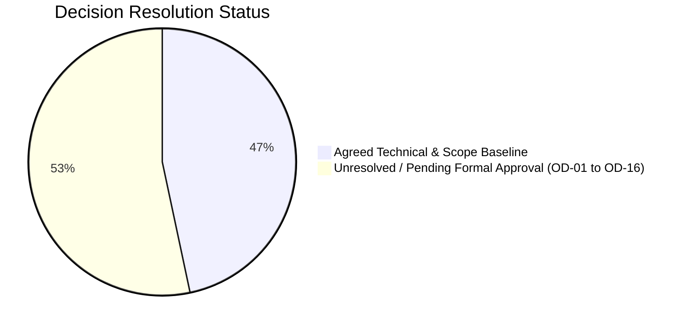

# UR GURU — Architectural & Business Decision Register

**Last Updated:** `17 November 2026`  
**Status:** Living Engineering Document  
**Scope:** Reconciled against BRD V5.0/V6.0, Business Rules V2.0, Stakeholder Decisions, and Consolidated Project Memory.

---

## 1. Executive Status: Agreed Baseline vs. Unresolved Items

---

## 2. Firmly Agreed Baseline Decisions `[AGREED / VERIFIED]`

| Decision Ref | Topic | Confirmed Decision | Rationale & Constraint |
|---|---|---|---|
| **ADR-01** | **Curriculum Scope** | **Strictly G.C.E. Advanced Level (A/L) Grade 12 & Grade 13**. | O/L, Grade 10, and Grade 11 are explicitly excluded from launch scope to focus marketing, teacher acquisition, and curriculum alignment. |
| **ADR-02** | **A/L Streams** | **4 Core Streams:** Physical Science / Bio Science, Commerce, Arts, Technology. | Syllabi, subject combinations, and past paper question banks align directly to Sri Lankan Department of Examinations standards. |
| **ADR-03** | **Core Actors** | **Student, Teacher, Administrator**. | Clean 3-actor model. Parent/Guardian is NOT a standalone portal at launch; restricted to contact name + phone number on the student profile. |
| **ADR-04** | **Platform Modality** | **Responsive Web Application Only**. | Single web ecosystem: Student/Teacher web application + dedicated Administrator web portal backed by a unified Web API. Mobile apps (Flutter) deferred. |
| **ADR-05** | **Backend Technology** | **C# ASP.NET Core Web API**. | Selected for high enterprise reliability, strong typing, clean DDD architecture, robust async I/O, and fast execution. |
| **ADR-06** | **Catalog vs Offerings** | **Admin owns Master Syllabus; Teachers create Offerings**. | Distinguish administrative `Subject` / `Topic` master catalog from teacher-created class batches and schedules (`Course` / `ClassSession`). |
| **ADR-07** | **Tuition Revenue Nature** | **Student Class Fee = GMV, NOT Platform Revenue**. | UR GURU only earns platform commission. Teacher receives the net contractual share. Ledgers must treat these distinctively. |
| **ADR-08** | **Digital Product Ledger** | **Separate Tuition Ledger from Exam Munnodi Ledger**. | Live class fees and digital mock/subscription revenues have different refund rules, tax treatments, and teacher compensation mechanics. |
| **ADR-09** | **Server-Authoritative State** | **Zero Client-Side Trust on Payment, Answers & Scoring**. | No client redirect confirms payment; webhook/server verification is mandatory. No answer keys sent to browser during exams. |
| **ADR-10** | **Exam Munnodi Scope** | **5 Years of A/L Past-Paper MCQs with Dual Explanations**. | Topic-based and all-topic mocks, difficulty calibrated, written explanations guaranteed, teacher video explanations staged. |
| **ADR-11** | **Teacher Paper Assignment** | **Teachers assemble approved questions, assign to multiple students**. | Reused papers create independent student attempt records without overwriting historical results. |
| **ADR-12** | **Content Governance** | **Zero Silent Overwrites on Question Edits**. | Attempts snapshot the exact question version at time of test generation. Corrections follow a controlled regrade policy. |
| **ADR-13** | **Live Session Access** | **Strict Authorized Join Validation**. | Only students with confirmed payment/booking and teachers assigned to the session receive valid room join tokens. |
| **ADR-14** | **Delivery Timeline Reality** | **Nov 30, 2026 is an Aspirational Target, Not Signed SLA**. | Team of 3–5 developers will deliver a working, fully-tested core marketplace vertical slice rather than incomplete placeholders. |

---

## 3. Formal Open Decisions Register (OD-01 to OD-16) `[OPEN / PENDING APPROVAL]`

| ID | Decision Area | Core Dilemma & Impact | Suggested Owner | Current Status |
|---|---|---|---|---|
| **OD-01** | **Teacher Verification Standards** | Mandatory qualification proofs (Degree, Teaching Diploma, Police Clearance/NIC). | Product + Operations | `Pending Policy Sign-off` |
| **OD-02** | **Free Trial Rules & Limits** | Max trial duration (30 min vs 1 hour); max trials per student (e.g. 1 per teacher); teacher trial opt-out policy. | Product + Operations | `Pending Policy Sign-off` |
| **OD-03** | **Tuition Commission Rate** | 15% is historical placeholder in drafts. Exact percentage and tiering (flat vs volume-based) needed. | Owner + Finance | `Pending Commercial Sign-off` |
| **OD-04** | **Refund & Cancellation Policy** | Cutoff window for student cancellations (e.g., 24h prior = 100% refund; <2h = no refund). Gateway fee absorption rule. | Finance + Product | `Pending Policy Sign-off` |
| **OD-05** | **Payment Gateway Procurement** | Selection among Sri Lankan gateways: PayHere, WEBXPAY, Direct Bank IPG, Genie. Commercial rates and webhook SLAs. | Finance + Engineering | `Vendor Evaluation Active` |
| **OD-06** | **Live Video & Media CDN** | Video room provider: LiveKit Cloud vs Agora vs 100ms. Video explanation storage: AWS S3 + CloudFront vs Azure Blob + CDN. | Engineering + Product | `Technical Benchmark Active` |
| **OD-07** | **Past-Paper Licensing & Rights** | Department of Examinations copyright clearance, public past paper fair-use verification, and attribution text. | Legal + Academic Lead | `Pending Legal Review` |
| **OD-08** | **5-Year Past-Paper Coverage Inventory** | Exact inventory of available MCQs across Science, Commerce, Arts, Tech for 2020–2025. Identification of missing questions/diagrams. | Academic Lead | `Inventory in Progress` |
| **OD-09** | **Question Review & Regrading Policy** | Workflow when an approved question has an erratum reported. Automatic regrade window vs manual review. | Academic Lead + Product | `Drafted in BRD; Pending Sign-off` |
| **OD-10** | **Mock Exam Defaults & Timers** | Standard MCQ count presets (20, 30, 50 questions); default timer (e.g., 2 mins/question); retake limits. | Product + Academic Lead | `Drafted; UI Configurable` |
| **OD-11** | **Difficulty Calibration Rules** | Objective algorithm for labeling `Easy` / `Medium` / `Hard` (e.g., % of past students answering correctly). | Academic Lead | `Pending Calibration Baseline` |
| **OD-12** | **Teacher Video Compensation & IP** | Fixed payment per approved explanation video (e.g., LKR 1,500/video) vs revenue share pool. Copyright assignment to UR GURU. | Owner + Finance + Legal | `Pending Contract Template` |
| **OD-13** | **Exam Munnodi Monetization** | Freemium allowance (e.g., 3 free mocks/month) vs Subscription (monthly LKR fee) vs Pack Purchase (LKR per subject pack). | Owner + Finance + Product | `Pending Pricing Model` |
| **OD-14** | **Teacher Pro Tools SaaS** | Whether teacher paper builder and class analytics should be free at launch to spur adoption, or paid Pro tier. | Owner + Product | `Recommended Free for Launch` |
| **OD-15** | **Minor Consent & Safeguarding** | NIC / Guardian consent threshold (Sri Lankan age of consent / financial transaction guidelines for 16-18 year olds). | Legal + Product | `Profile Contact Info Sufficient for P1` |
| **OD-16** | **Release Scope, Staffing & Dates** | Final sign-off on 3–5 developer sprint plan, MVP milestone scope freeze, and realistic production launch date. | Sponsor + PM + Engineering | `Active Planning` |

---

## 4. Architectural Decisions Record (ADR) Process

When resolving any of the open items above:
1. Document the context, chosen option, rejected options, and consequences in an ADR file under `13-DECISION-LOG/ADR-XXX-<name>.md`.
2. Update the corresponding database migration and API contract.
3. Link the ADR to the related Functional Requirement (`BR-XX`) and Acceptance Criterion (`AC-XX`).
