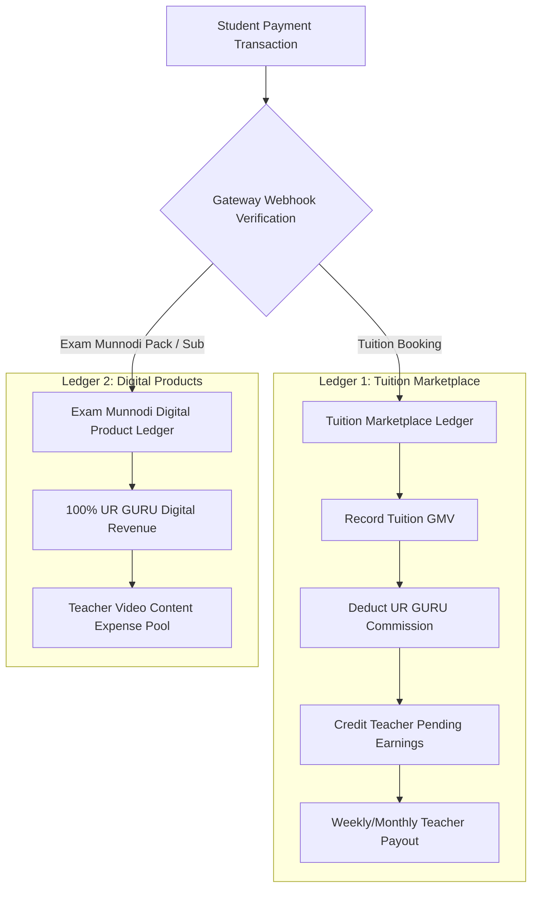

# UR GURU — Financial Architecture & Transaction Ledger

**Module Code:** `MOD-FINANCE`  
**Version:** `1.0` | **Date:** `17 November 2026`  
**Status:** Approved Architectural Model (Aligned with BRD V5.0/V6.0 & Accounting Principles)

---

## 1. Core Financial Principles

### 1.1 Gross Merchandise Value (GMV) vs Platform Revenue
A foundational accounting principle for the UR GURU tuition marketplace:
$$\text{Tuition GMV} = \sum \text{Gross Class Fees Paid by Students}$$
$$\text{UR GURU Tuition Revenue} = \text{Tuition GMV} \times \text{Commission Rate} - \text{Gateway Costs (if absorbed)}$$
$$\text{Teacher Payable Liability} = \text{Tuition GMV} \times (1 - \text{Commission Rate})$$

> [!IMPORTANT]
> Student class fees must **NEVER** be booked as UR GURU gross operating revenue. The platform operates as a marketplace intermediary for tuition services.
> However, **Exam Munnodi subscriptions and one-off mock exam packs are digital products owned directly by UR GURU**, and are recognized 100% as UR GURU operating revenue (subject to content licensing costs and teacher explanation video production stipends).

---

## 2. Ledger Architecture: Dual Ledger Segregation

To maintain clean financial audits, tax compliance, and seamless refund processing, the financial engine maintains two completely isolated ledgers:



---

## 3. Revenue Streams & Monetization Mechanisms

| Revenue Stream | Transaction Nature | Revenue Recognition | Current Commercial Status |
|---|---|---|---|
| **Tuition Class Commission** | Marketplace fee | On live class completion | Proposed 15% (Subject to `OD-03` sign-off) |
| **Exam Munnodi Monthly Subscription** | Recurring digital SaaS | Amortized across billing cycle | Proposed LKR tier (Subject to `OD-13`) |
| **Exam Munnodi Mock Exam Packs** | One-time digital entitlement | Immediately upon purchase | Proposed LKR pack fee (Subject to `OD-13`) |
| **Teacher Explanation Video Stipends** | Operational Cost / Sharing | Expense per approved video | Fixed fee / pool model (Subject to `OD-12`) |
| **Teacher Pro Tools (Future)** | B2B SaaS for educators | Recurring monthly/annual | Future evaluation (`OD-14`) |
| **School / Institute Licensing** | B2B Institutional contract | Contract milestone terms | Future Phase |

---

## 4. Refund & Cancellation Rules (`OD-04`)

### 4.1 Live Tuition Classes
- **Teacher Cancellation:** If a teacher cancels a scheduled class and does not offer an accepted reschedule within 7 days, 100% of the student's tuition fee is refunded to the original payment method or credited to the student wallet.
- **Student Cancellation (> 24 hours before class):** 100% refund minus payment gateway transaction fees (if applicable).
- **Student Cancellation (< 2 hours before class / No-show):** Non-refundable; teacher has reserved capacity and class slot.
- **Technical Disruption (> 50% session lost due to platform error):** Automatic prorated refund or replacement session credit.

### 4.2 Exam Munnodi Digital Products
- Mock exam packs and subscription fees are non-refundable once practice exams have been generated or question banks accessed, except in verified technical outage cases.

---

## 5. Teacher Payout Lifecycle

```mermaid
sequenceDiagram
    autonumber
    actor Teacher
    participant API as C# Web API
    participant Ledger as Financial DB
    participant Bank as Sri Lankan Banking / IPG
    
    Note over Ledger: Class Session Conducted & Attendance Verified
    Ledger->>Ledger: Move teacher earnings from PENDING to AVAILABLE
    Teacher->>API: View Earnings Dashboard & Request Payout / Scheduled Cycle
    API->>Ledger: Validate Available Balance >= Minimum Threshold (e.g., LKR 2,000)
    API->>Ledger: Lock payout amount; create PayoutRecord (Status=Processing)
    API->>Bank: Execute SLIPS / CEFTS Direct Bank Transfer
    Bank-->>API: Transfer Confirmation (UTR / Transaction Reference)
    API->>Ledger: Update PayoutRecord (Status=Completed, SettledAt=Timestamp)
    API-->>Teacher: Payout Statement & Notification
```

---

## 6. Database Schema Alignment (`UR_GURU_A_L_ONLY_V2_PostgreSQL.sql`)

The database directly supports this financial structure through the following 7 dedicated financial tables:
1. `payments`: Parent order and gateway transaction reference.
2. `payment_transactions`: Idempotent gateway transaction attempts and webhooks.
3. `refunds`: Granular refund requests, approval state, and gateway refund IDs.
4. `teacher_earnings`: Per-class-booking earnings linked to specific `booking_id`.
5. `platform_commissions`: Commission rate snapshot and retained platform fee.
6. `teacher_payouts`: Payout batch record with bank transfer references.
7. `payout_items`: Line items linking specific `teacher_earnings` to a payout.
