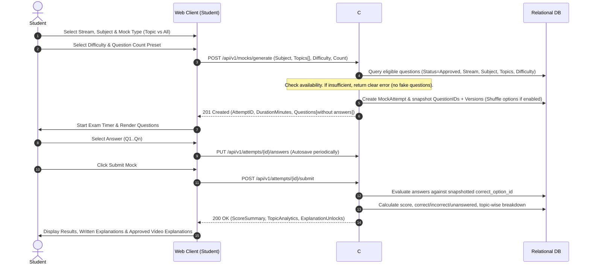
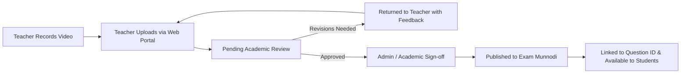

# Exam Munnodi — Full Technical & Functional Specification

**Module Code:** `MOD-EXAM-MUNNODI`  
**Version:** `1.0` | **Date:** `17 November 2026`  
**Status:** Canonical Engineering Specification (Aligned with BRD V5.0/V6.0 & Consolidated Project Memory)  
**Target Curriculum:** Sri Lankan G.C.E. Advanced Level (Grade 12 & Grade 13)

---

## 1. Executive Summary & Core Mission

**Exam Munnodi** is UR GURU’s dedicated past-paper MCQ practice, diagnostic assessment, and mock-examination engine. It provides Sri Lankan A/L students across four streams (Science, Commerce, Arts, Technology) with targeted practice from a curated five-year past-paper question bank, verified answer keys, written explanations, and teacher-recorded video explanations.

### Key Capabilities:
1. **Student Self-Paced Practice:** Student chooses stream, subject, topic selection (specific topics vs. all topics), and difficulty (`Easy`, `Medium`, `Hard`, or admin-configured distribution).
2. **Deterministic Server-Side Mock Engine:** Backend validates question eligibility, generates un-duplicated question sets, enforces exam timer and submission rules, and grades submissions server-side against immutable answer keys.
3. **Multi-Media Explanations:** Comprehensive written explanations plus administrator-approved teacher-recorded video walkthroughs.
4. **Teacher Paper Builder & Multi-Student Assignment:** Verified teachers construct custom assessments from approved questions and assign them simultaneously to multiple students with deadlines, attempt limits, and independent result tracking.
5. **Progress & Weakness Diagnostics:** Topic-level performance analytics feeding into student revision insights without fabricating premature AI claims.

---

## 2. Information Architecture & Question Bank Metadata

Every question in the Exam Munnodi item bank is an immutable, version-controlled entity.

### 2.1 Question Bank Item Schema
| Field | Type | Description / Constraints |
|---|---|---|
| `question_id` | UUID / INT (PK) | Globally unique stable identifier |
| `stream_id` | FK -> `streams` | Physical Science, Bio Science, Commerce, Arts, Technology |
| `subject_id` | FK -> `subjects` | e.g. Combined Maths, Physics, Chemistry, Accounting, Econ, etc. |
| `syllabus_version` | VARCHAR(20) | Effective syllabus year (e.g. `2019-REV`) |
| `topic_id` | FK -> `topics` | Primary syllabus topic |
| `subtopic_id` | FK -> `subtopics` (Nullable) | Granular subtopic classification |
| `source_year` | INT | Year of past paper (e.g., `2021`, `2022`, `2023`, `2024`, `2025`) |
| `source_paper_number` | SMALLINT | Usually Paper I (MCQ) |
| `source_question_number` | INT | Original question index on paper (e.g., Q14) |
| `difficulty_level` | ENUM | `Easy`, `Medium`, `Hard` (Admin/Reviewer calibrated) |
| `marks` | DECIMAL(4,2) | Default standard mark (e.g., 1.00) |
| `negative_marks` | DECIMAL(4,2) | Default `0.00`; non-zero only if explicitly configured |
| `question_text` | TEXT / NVARCHAR(MAX) | Question stem (supports Markdown, LaTeX math formatting) |
| `question_image_url` | VARCHAR(500) (Nullable) | Signed URL for diagrams/equations |
| `options_json` | JSON / NVARCHAR(MAX) | Array of 4 or 5 options with option IDs and content |
| `correct_option_id` | VARCHAR(10) | Approved answer key identifier |
| `written_explanation` | TEXT / NVARCHAR(MAX) | Step-by-step academic solution and reasoning |
| `status` | ENUM | `Draft`, `UnderReview`, `Approved`, `Rejected`, `Archived`, `Withdrawn` |
| `content_rights_status` | ENUM | `VerifiedLicensed`, `FairUseReview`, `PendingLicense`, `Restricted` |
| `version_number` | INT | Incremented on correction; historical attempts pin version |
| `reviewed_by` | FK -> `users` | Academic reviewer user ID |
| `reviewed_at` | DATETIME | Timestamp of academic approval |

---

## 3. Student Mock Exam Journey

### 3.1 Flow Breakdown

### 3.2 Anti-Cheat & Integrity Rules
- **No Client-Side Answers:** The client bundle NEVER receives `correct_option_id` or `written_explanation` during an active attempt.
- **Immutable Snapshot:** The attempt record stores the exact `version_number` of each question at generation time. If a question is edited or revised later, past student results and attempts remain completely untainted.
- **Idempotent Submission:** Duplicate submit button clicks or network retries use an idempotency token (`AttemptId + SessionToken`), preventing double marking or duplicate records.

---

## 4. Teacher Paper Builder & Assignment Engine

Teachers cannot alter source past-paper questions in the global bank, but they have powerful curation and distribution tools.

### 4.1 Capabilities & Workflow
1. **Curate:** Teacher filters approved questions by subject, syllabus topic, past year, and difficulty.
2. **Draft & Reorder:** Selected questions are added to a draft teacher paper; teacher defines order and custom point weights (if allowed).
3. **Publish Paper:** Teacher finalizes the paper as a reusable assessment template.
4. **Multi-Student Assignment (`POST /api/v1/assignments`):**
   - Target audience: specific enrolled class roster, custom student group, or multi-selected student IDs.
   - Parameters: `available_from`, `due_date`, `time_limit_minutes`, `max_attempts` (default 1).
   - In-app notification sent immediately or scheduled.
5. **Independent Student Attempts:** Each assigned student receives their own `student_assignment_attempt` record.
6. **Teacher Analytics Dashboard:**
   - Teacher views class-wide completion rates, average scores, and topic-by-topic difficulty breakdowns.
   - Strict privacy: Teachers only see results for students assigned to their own papers or enrolled in their own classes.

---

## 5. Explanation Video Production & Review Pipeline

### 5.1 Controls & Governance
- **Upload Specs:** MP4/WebM, 1080p max, standardized intro/outro watermark.
- **Review Criteria:** Academic correctness, audio/video clarity, language appropriateness, copyright/IP compliance.
- **Fallback Rule:** If video fails to load, CDN drops, or video is still in production, the written explanation is ALWAYS displayed.
- **Teacher Compensation:** Per-approved-video stipend or revenue pool allocation tracked in `16-FINANCE` ledgers.

---

## 6. API Surface (Exam Munnodi Endpoints)

| Method | Endpoint | Access Role | Description |
|---|---|---|---|
| `GET` | `/api/v1/exam/catalog` | Public / Student | Get streams, subjects, syllabus versions, and topics |
| `GET` | `/api/v1/questions/search` | Teacher / Admin | Search approved questions with filters |
| `POST` | `/api/v1/mocks/generate` | Student | Generate new mock exam based on criteria |
| `GET` | `/api/v1/attempts/{id}` | Student | Fetch active mock exam questions (no answers) |
| `PUT` | `/api/v1/attempts/{id}/autosave` | Student | Autosave selected options periodically |
| `POST` | `/api/v1/attempts/{id}/submit` | Student | Finalize mock attempt and trigger server scoring |
| `GET` | `/api/v1/attempts/{id}/results` | Student | Get score breakdown, correct keys, explanations |
| `POST` | `/api/v1/teacher/papers` | Teacher | Create draft or published custom paper |
| `POST` | `/api/v1/teacher/assignments` | Teacher | Assign paper to multiple students |
| `GET` | `/api/v1/teacher/assignments/{id}/analytics` | Teacher | Aggregated and individual student performance |
| `POST` | `/api/v1/explanations/videos/upload-ticket` | Teacher | Request presigned URL for explanation video upload |
| `POST` | `/api/v1/admin/questions/review` | Admin / Reviewer | Approve/reject question edits or video submissions |

---

## 7. Acceptance Criteria (AC Traceability)

- **AC-03:** Only approved active questions matching the student's selected stream/subject/topics/difficulty are returned.
- **AC-04:** Topic mock contains questions strictly bounded by selected topics.
- **AC-05:** All-topic mock includes representative distribution across full subject syllabus.
- **AC-07 (Question Shortage):** If fewer than requested questions exist for a filter combination, return exact available count with user explanation. Never inject dummy questions.
- **AC-08 & AC-15:** Server-side grading with idempotency guarantees no corrupted attempts or double grading.
- **AC-11:** Video failure gracefully defaults to written explanation.
- **AC-13 & AC-14:** Multi-student assignment creates independent records; strict role-based data protection isolates results between teachers.
