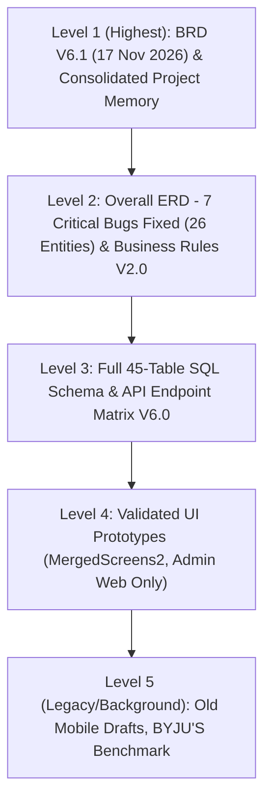

# UR GURU — Source Document & Artifact Registry

**Last Updated:** `17 November 2026`  
**Purpose:** Canonical inventory of all project documents, specifications, prototypes, and schema files. Defines the hierarchy of truth across the project.

---

## 1. Hierarchy of Truth & Authority Matrix

When specifications differ, resolve conflicts using the following precedence hierarchy:

---

## 2. Core Repository Artifact Inventory

| Category | Filename / Artifact | Path | Status / Role | Authority Level |
|---|---|---|---|---|
| **Latest BRD** | `UR_GURU_BRD_V6_1_CORRECTED_BASELINE.md` | `UR-GURU-SECOND-BRAIN/02-BRD-AND-REQUIREMENTS/` | **Canonical Requirements Baseline (V6.1)** | **Level 1** |
| **Consolidated Memory** | `CONSOLIDATED_PROJECT_MEMORY_2026-11-17.md` | `UR-GURU-SECOND-BRAIN/19-CHAT-MEMORY/` | Active Governing Charter | **Level 1** |
| **Latest Clean ERD** | `UR_GURU_ERD_7_CRITICAL_BUGS_FIXED.jpg` | `UR-GURU-SECOND-BRAIN/07-DATABASE-DESIGN/` | **Canonical ERD (26 Entities, 7 Critical Bugs Fixed)** | **Level 2** |
| **Business Rules** | `UR_GURU_Business_Rules_V2_0.docx` | `UR-GURU-SECOND-BRAIN/09-BUSINESS-RULES/` | 77 Explicit Business Rules (BR-001 to BR-077) | **Level 2** |
| **API Matrix** | `UR_GURU_API_List_V6_0(1).xlsx` | `D:\Unicom\final project docs\` | 161 Active Endpoints + 7 Deprecated Guardian Endpoints | **Level 3** |
| **Database Schema (SQL)**| `UR_GURU_A_L_ONLY_V2_PostgreSQL.sql` | `D:\Unicom\final project docs\UR_GURU_A_L_ONLY_ERD_V2_Complete_Package\` | 45-Table Normalized Relational Schema | **Level 3** |
| **Database Model (DBML)**| `UR_GURU_A_L_ONLY_V2.dbml` | `D:\Unicom\final project docs\UR_GURU_A_L_ONLY_ERD_V2_Complete_Package\` | Complete DBML source for ERD tools | **Level 3** |
| **ERD Visuals** | `UR_GURU_V2_Full_45_Tables.svg` | `D:\Unicom\final project docs\UR_GURU_A_L_ONLY_ERD_V2_Complete_Package\` | Full System Entity Relationship Diagram | **Level 3** |
| **Web UI Prototype** | `MergedScreens2.html` | `D:\Unicom\final project docs\` | Integrated Student & Teacher Responsive Prototype | **Level 4** |
| **Admin UI Prototype** | `UR_GURU_Admin_Web_Only_Updated.html` | `D:\Unicom\final project docs\` | Administrator Management Portal Prototype | **Level 4** |
| **Screen Inventory** | `UR_GURU_Student_Screen_Inventory.json` | `D:\Unicom\UR_GURU_Student_UI_Web_and_Mobile_Updated_V5\...` | 30 Journeys, 200 Steps, 77 Screen IDs | **Level 4** |
| **Visual Style Guide** | `UR_GURU_UI_Theme_Design_System.docx` | `D:\Unicom\final project docs\` | Typography, Spacing, Indigo/Violet Color Tokens | **Level 4** |
| **Exam Munnodi Spec** | `EXAM_MUNNODI_FULL_SPEC.md` | `UR-GURU-SECOND-BRAIN/17-EXAM-MUNNODI/` | Mock Exam Engine & Paper Builder Blueprint | **Level 2** |
| **Finance Architecture**| `FINANCIAL_ARCHITECTURE_AND_LEDGER.md`| `UR-GURU-SECOND-BRAIN/16-FINANCE/` | Dual Ledger, GMV, Commission & Payouts | **Level 2** |
| **Decisions Register** | `DECISIONS_AND_OPEN_ITEMS.md` | `UR-GURU-SECOND-BRAIN/13-DECISION-LOG/` | ADR-01..14 & OD-01..16 Tracking | **Level 1** |
| **Issues & Changelog** | `ISSUES_AND_CHANGELOG.md` | `UR-GURU-SECOND-BRAIN/15-ISSUES-AND-CHANGELOG/` | Change History, Bug-001 Fix, Known Issues | **Level 2** |

---

## 3. Explicitly Deprecated or Out-of-Scope Items

1. **Grade 10, Grade 11, and O/L Curricula:** Excluded from all user journeys, forms, and database schemas.
2. **Flutter Mobile Application:** Deferred; current scope is responsive web only.
3. **Standalone Parent/Guardian Account:** Replaced with contact fields on student profile.
4. **Unreviewed / AI-Generated Answers:** Prohibited; all question keys and explanations require verified academic sign-off.
5. **BYJU'S Document:** Used strictly as background market research; does not represent UR GURU pricing or operations.

## 22 Nov 2026 correction precedence
**Current governing review baseline:** `02-BRD-AND-REQUIREMENTS/UR_GURU_Full_Corrected_BRD_v6.2.2.pdf` (unsigned). `README.md`, XACT current gateway and dated correction audit supersede old summary language. Existing 17 Nov consolidated memory, old audit and historical Exam Munnodi spec are **historical**, not scope authority. API source entries are draft contracts; 52 deferred endpoints have no authoritative source list. Discussion-selected providers are not signed vendor approval.
